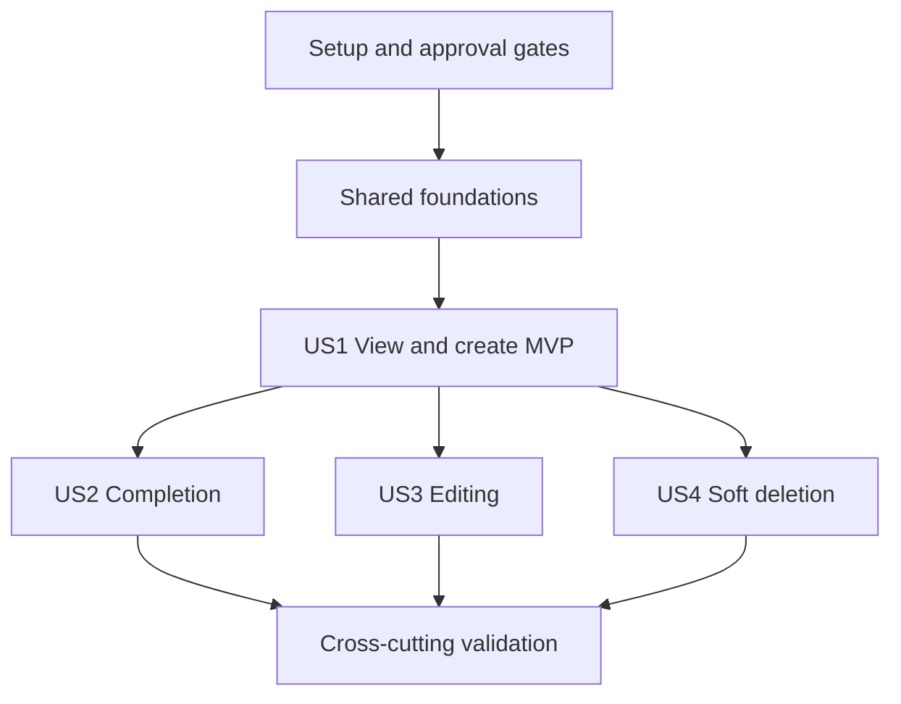

# Tasks: Single-User ToDo CRUD

**Input**: Design artifacts in `specs/001-todo-crud/`.
**Prerequisites**: [plan.md](plan.md), [spec.md](spec.md), [data-model.md](data-model.md),
[REST contract](contracts/rest-api.md), [research.md](research.md),
[quickstart.md](quickstart.md), [structure constraints](planning-constraints.md), and the constitution.

**Tests**: TDD is required. For each behaviour, write tests, run and observe a meaningful failure,
implement the minimum passing change, then refactor. Test-writing tasks are complete only after
observing the expected failures; story checkpoints require all related tests passing.
**Paths**: Repository-relative; no nested todo-app project. Only description and dueAt are optional.
**Format**: `- [ ] Tnnn [P?] [USn?] Description with paths`. [P] indicates disjoint work within
its phase's test/setup batch after the prerequisite gates, not permission to bypass dependencies.

## Phase 1: Setup (Shared Infrastructure)

**Goal**: Prepare the approved toolchain and prescribed repository layout.

**Independent Test / Gate**: No dependency may be installed before the review/approval task is complete.

- [ ] T001 Document exact dependency versions, purposes, capability gaps and alternatives from research.md in specs/001-todo-crud/dependency-review.md; record existing explicit approvals and obtain approval for still-unapproved introductions/installations before proceeding.
- [ ] T002 Reconcile the explicitly requested Axios addition in .specify/memory/constitution.md using the constitution amendment procedure, including version and sync report; preserve existing principles.
- [ ] T003 After T001–T002 gates pass, initialise package.json and package-lock.json with only the approved dependencies, Node 24 engine and ESM; create the directories required by specs/001-todo-crud/planning-constraints.md without a nested application root.
- [ ] T004 [P] Configure strict shared/server/client builds in tsconfig.json, tsconfig.server.json and tsconfig.client.json; configure the approved lint toolchain in eslint.config.js.
- [ ] T005 [P] Configure React entry/build and loopback /api proxy in vite.config.ts and index.html; provide a minimal src/client/main.tsx and src/client/App.tsx mount.
- [ ] T006 [P] Configure Vitest unit, integration and DOM component projects in vitest.config.ts and tests/unit/client/setup.ts using only approved tooling.
- [ ] T007 Add db:generate, db:migrate, db:deploy, dev:server, dev:client, test:unit, test:integration, test:components, typecheck, lint, build and start scripts in package.json as specified by quickstart.md.
- [ ] T008 Add placeholder configuration in .env.example and ignore development/test SQLite files, journals, WAL/SHM files, generated Prisma output and test artefacts in .gitignore; never add real credentials.

**Checkpoint**: Phase gate verified; continue only after its dependencies are satisfied.

## Phase 2: Foundational (Blocking Prerequisites)

**Goal**: Establish tested shared validation, persistence configuration and HTTP boundaries.

**Independent Test / Gate**: Complete this phase before story implementation. Write and observe each behaviour test failing before its implementation.

- [ ] T009 [P] Write failing shared validation tests in tests/unit/shared/todo-schema.test.ts for trimmed title 1–120, optional description ≤500, blank-to-null, nullable dueAt, timezone/calendar validation, strict fields, PATCH omission versus clearing, nonempty PATCH and explicit Boolean completion.
- [ ] T010 Implement shared DTO/response schemas and inferred types in src/shared/schemas/todo.schema.ts, src/shared/types/todo.ts and src/shared/constants/todo.ts; UTC-normalise provided dates and make the T009 tests pass.
- [ ] T011 [P] Write failing environment and HTTP-boundary tests in tests/unit/server/config.test.ts and tests/integration/api/errors.test.ts for startup config, malformed JSON, UUID/query validation, unknown fields, 400/404/413/415 and generic 500 responses without internal details.
- [ ] T012 Implement validated configuration and safe domain errors in src/server/config/env.ts and src/server/utils/errors.ts; implement src/server/validators/todo.validator.ts and src/server/middleware/validate.ts, error-handler.ts and not-found.ts to pass T011.
- [ ] T013 Configure Prisma 7 generation, SQLite ISO timestamps and database URL resolution in prisma.config.ts and src/server/config/prisma.ts; only repository modules may perform Prisma data operations.
- [ ] T014 Create a reusable isolated SQLite lifecycle in tests/integration/database.ts: unique file per worker, committed migrations applied, development-URL refusal, client close and cleanup restricted to owned temporary files; verify safeguards in tests/integration/database.test.ts.
- [ ] T015 Compose testable Express setup in src/server/app.ts and server listen/graceful shutdown in src/server/index.ts; mount /api/todos and error middleware, enforce JSON content/body limits, bind loopback and leave behaviour endpoints for story tasks.
- [ ] T016 Create the Axios instance in src/client/services/http.ts with /api base URL, timeout, cancellation, safe typed error mapping and no mutation auto-retry; write failing tests first in tests/unit/client/http.test.ts and make them pass.

**Checkpoint**: Phase gate verified; continue only after its dependencies are satisfied.

## Phase 3: User Story 1 - View and Create ToDos (Priority: P1) — MVP

**Goal**: Show the ordered default list and create tasks through the replacing form.

**Independent Test / Gate**: From an empty migrated database create two title-only tasks, check ordinals 0/1 and null optional values, cancel a draft, reload/restart and verify persistence and ordering.

- [ ] T017 [P] [US1] Write failing migrated-database tests in tests/integration/repositories/todo-create-list.test.ts for UUID/defaults/nullability, indexes/unique ordinal, lifetime max including deleted rows, simultaneous creates, rollback, actual adapter conflict mapping, bounded retries/503, overflow and raw UTC timestamp persistence.
- [ ] T018 [P] [US1] Write failing service tests in tests/unit/server/todo-create-list.service.test.ts and Supertest contract tests in tests/integration/api/todo-create-list.test.ts for GET list/detail, POST, Location/201, defaults, inclusive queries, strict input, deleted/missing 404 and UTC responses.
- [ ] T019 [P] [US1] Write failing local datetime tests in tests/unit/client/datetime.test.ts for optional blank values, local↔UTC conversion, offsets/date boundaries, unchanged instants, DST gap rejection and the planned overlap policy.
- [ ] T020 [P] [US1] Write failing RTL flows in tests/unit/client/todo-create-list.test.tsx for one list, exact right-side button order, empty/loading/retry states, list→form→save/cancel→list, failed-save retention, focus and validation messages under each control.
- [ ] T021 [US1] Define Todo in prisma/schema.prisma and generate the initial version-controlled migration in prisma/migrations/: UUID, required title, nullable description/dueAt, unique ordinal, completed/deleted defaults, timestamps and both planned indexes; pass schema checks in T017.
- [ ] T022 [US1] Implement create/list/detail in src/server/repositories/todo.repository.ts: deleted predicates, ordinal sort, lifetime max+insert transaction, unique protection, three bounded whole-transaction attempts on verified rollback conflicts and safe overflow/busy outcomes.
- [ ] T023 [US1] Implement create/list/detail business operations in src/server/services/todo.service.ts using a narrow explicit repository collaborator, UTC-normalised DTOs and not-found/domain outcomes; no Prisma imports or HTTP concerns.
- [ ] T024 [US1] Connect GET /api/todos, GET /api/todos/:id and POST /api/todos in src/server/controllers/todo.controller.ts and src/server/routes/todo.routes.ts with strict validators, consistent envelopes, status codes and Location; pass T018.
- [ ] T025 [US1] Implement local date conversion/display in src/client/utils/datetime.ts, preserving unchanged instants, nullable absence and DST validation; pass T019.
- [ ] T026 [US1] Implement list/detail/create Axios calls in src/client/services/todo-api.ts with response-schema validation and cancellation support; extend tests/unit/client/http.test.ts for malformed responses and uncertain mutation failures.
- [ ] T027 [US1] Implement list/loading/error/retry/refresh in src/client/hooks/useTodos.ts with request-generation guards and cancelled obsolete reads; add failing-then-passing race tests in tests/unit/client/useTodos.test.tsx.
- [ ] T028 [US1] Implement RHF/zodResolver creation in src/client/components/todo/TodoForm.tsx with required title, optional description/dueAt, nullable conversion, Save/Cancel, first-error focus and accessible errors directly below each input.
- [ ] T029 [US1] Implement src/client/components/todo/TodoList.tsx, TodoItem.tsx and TodoListActions.tsx plus src/client/pages/TodosPage.tsx list/create state: hide list/action group during creation, restore after success/cancel, retain draft after failure, preserve filter state and restore focus; wire Display completed visibility to the inclusive list request.
- [ ] T030 [US1] Add semantic layout and responsive right-side actions in src/client/layouts/AppLayout.tsx and src/client/styles/app.css, mount TodosPage in src/client/App.tsx and show local timestamps/absent-field text; pass T020 and record US1 smoke results in specs/001-todo-crud/quickstart.md.

**Checkpoint**: All story tests pass and the independent scenario is demonstrated.

## Phase 4: User Story 2 - Complete and Reopen ToDos (Priority: P1)

**Goal**: Set explicit completion state and display completed tasks alongside incomplete tasks.

**Independent Test / Gate**: Seed both states, verify default hiding, toggle Display completed to include both in ordinal order, complete/reopen and verify filter retention and reload defaults.

- [ ] T031 [P] [US2] Write failing completion service/repository tests in tests/unit/server/todo-completion.service.test.ts and tests/integration/repositories/todo-completion.test.ts for explicit true/false, repeated state, preserved content/order and deleted exclusions.
- [ ] T032 [P] [US2] Write failing Supertest cases in tests/integration/api/todo-completion.test.ts for PATCH /:id/completion, Boolean-only bodies, deleted/missing IDs, inclusive/default list visibility and UTC updatedAt.
- [ ] T033 [P] [US2] Write failing RTL tests in tests/unit/client/todo-completion.test.tsx for Display completed pressed state/second click, both states together, explicit checkbox targets, pending/failure feedback, focus after disappearance and preserved filter after creation/cancel.
- [ ] T034 [US2] Implement atomic explicit completion in src/server/repositories/todo.repository.ts and src/server/services/todo.service.ts; preserve content/ordinal and guard deleted=false, passing T031.
- [ ] T035 [US2] Connect PATCH /api/todos/:id/completion in src/server/controllers/todo.controller.ts and src/server/routes/todo.routes.ts using the strict completion schema; pass T032.
- [ ] T036 [US2] Add explicit completion requests in src/client/services/todo-api.ts and src/client/hooks/useTodos.ts; wire pending-safe item controls and accessible visibility feedback in src/client/components/todo/TodoItem.tsx, TodoListActions.tsx and src/client/pages/TodosPage.tsx; pass T033 and record results in specs/001-todo-crud/quickstart.md.

**Checkpoint**: All story tests pass and the independent scenario is demonstrated.

## Phase 5: User Story 3 - Edit ToDo Content (Priority: P2)

**Goal**: Edit content and clear optional fields without changing identity, order or status.

**Independent Test / Gate**: Edit seeded tasks of each status, cancel once, clear optional fields and reload; save from two browser tabs and verify last successful content save wins.

- [ ] T037 [P] [US3] Write failing repository/service tests in tests/integration/repositories/todo-edit.test.ts and tests/unit/server/todo-edit.service.test.ts for partial updates, null clearing, omission preservation, last-save-wins and content/status race safety.
- [ ] T038 [P] [US3] Write failing Supertest PATCH tests in tests/integration/api/todo-edit.test.ts for valid partial content, empty/unknown/system-field rejection, validation boundaries, missing/deleted 404, preserved createdAt and UTC dates.
- [ ] T039 [P] [US3] Write failing RTL edit tests in tests/unit/client/todo-edit.test.tsx for prefilled local/optional inputs, unchanged due instant, null clearing, save/cancel return, retained filter, failures, inline errors and focus restoration.
- [ ] T040 [US3] Implement atomic allowlisted content updates in src/server/repositories/todo.repository.ts and src/server/services/todo.service.ts: omission preserves, null clears and last successful save wins without touching completed/deleted/ordinal/createdAt; pass T037.
- [ ] T041 [US3] Wire PATCH /api/todos/:id in src/server/controllers/todo.controller.ts and src/server/routes/todo.routes.ts with strict partial validation and consistent responses; pass T038.
- [ ] T042 [US3] Add edit calls/state in src/client/services/todo-api.ts and src/client/hooks/useTodos.ts; integrate edit-mode form and item action in src/client/components/todo/TodoForm.tsx, TodoItem.tsx and src/client/pages/TodosPage.tsx; pass T039 and record the edit acceptance result in specs/001-todo-crud/quickstart.md.

**Checkpoint**: All story tests pass and the independent scenario is demonstrated.

## Phase 6: User Story 4 - Remove ToDos (Priority: P2)

**Goal**: Soft-delete tasks without renumbering or exposing retained records.

**Independent Test / Gate**: Delete ordinals 1 then 2 from 0/1/2, create again and verify 3; delete all visible tasks and verify the next ordinal continues; detail/edit/completion of deleted records must be unavailable.

- [ ] T043 [P] [US4] Write failing deletion repository/service tests in tests/integration/repositories/todo-delete.test.ts and tests/unit/server/todo-delete.service.test.ts for retained flags, unchanged ordinals, deleted highest/all allocation and concurrent delete/edit/completion protection.
- [ ] T044 [P] [US4] Write failing Supertest tests in tests/integration/api/todo-delete.test.ts for DELETE 204/no body, repeat-delete 404, malformed/missing IDs and exclusion from list/detail/content/completion operations.
- [ ] T045 [P] [US4] Write failing RTL tests in tests/unit/client/todo-delete.test.tsx for deletion in both visibility modes, pending prevention, failure retention, empty-state actions and focus after removal.
- [ ] T046 [US4] Implement conditional soft deletion in src/server/repositories/todo.repository.ts and src/server/services/todo.service.ts; retain data/ordinal, update timestamp and return unavailable for no match, passing T043.
- [ ] T047 [US4] Wire DELETE /api/todos/:id in src/server/controllers/todo.controller.ts and src/server/routes/todo.routes.ts with validated UUID, 204 and safe 404; pass T044.
- [ ] T048 [US4] Add delete request/refresh in src/client/services/todo-api.ts and src/client/hooks/useTodos.ts and item controls in src/client/components/todo/TodoItem.tsx and src/client/pages/TodosPage.tsx; pass T045 and record results in specs/001-todo-crud/quickstart.md.

**Checkpoint**: All story tests pass and the independent scenario is demonstrated.

## Phase 7: Polish & Cross-Cutting Concerns

**Goal**: Validate the complete assessment without expanding scope.

**Independent Test / Gate**: All automated gates and the documented manual acceptance scenarios have recorded results.

- [ ] T049 Write failing built-app smoke tests in tests/integration/api/production.test.ts, then serve Vite assets with API-before-SPA fallback in src/server/app.ts and finalise resource shutdown in src/server/index.ts; verify start/build/db:deploy from package.json.
- [ ] T050 [P] Run keyboard, screen-reader, focus and contrast checks for every story using specs/001-todo-crud/quickstart.md; record findings and needed corrections in tests/e2e/manual-acceptance.md for resolution before T052.
- [ ] T051 [P] Execute 100-task visibility/order checks and 20 timed trials per list/filter/write action from specs/001-todo-crud/quickstart.md; record timing, the ≥19/20 under two seconds acceptance result, timezone evidence and any regressions in tests/e2e/performance-timezone.md for resolution before T052.
- [ ] T052 Resolve findings from T050–T051 using their affected source/test paths, then run test:unit, test:integration, test:components, typecheck, lint and build from package.json; verify migration reproducibility, restart persistence and database isolation; record commands/results and any unavailable manual checks in specs/001-todo-crud/validation-results.md.
- [ ] T053 Update README.md with approved setup, scripts, local-only scope and links to specs/001-todo-crud/quickstart.md; review git diff for secrets, generated databases, unintended dependencies and architecture violations, retaining focused changes without committing or pushing unless requested.

**Checkpoint**: Phase gate verified; continue only after its dependencies are satisfied.

## Dependencies & Execution Order

- T001 approval and T002 constitutional reconciliation block T003 dependency installation.
- After T003, T004–T006 may run together; finish setup before foundations.
- Foundation test tasks T009 and T011 may run together; T010 and T012 follow their tests.
  T013 then T014 establish database support. Complete T015–T016 before story work.
- US1 uses the shared entity and infrastructure. T017–T020 may be authored in parallel; the
  schema/migration and repository precede services/endpoints, followed by client integration.
- US2, US3 and US4 use US1's list, model and forms. Each can be tested with seeded records and
  does not require the other two features. Their race tests seed state through repository/test
  fixtures rather than depending on another story's unfinished public endpoint.
- Run implementation phases in the displayed order: they modify shared repository, service,
  controller, route, hook and component files. Do not concurrently edit those same files.
- Within each story, the three disjoint test tasks can run together. Each implementation task
  depends on the applicable tests and preceding lower-layer implementation in that story.
- Final validation waits for all four stories. T050 and T051 may use separate acceptance data
  and result files; coordinate any fixes to shared source before the final full test run.

## Parallel Execution Examples per Story

| Story | Disjoint test-writing batch after foundations/US1 prerequisites |
|---|---|
| US1 | T017 repository; T018 API/service; T019 datetime; T020 form/list |
| US2 | T031 repository/service; T032 API; T033 component flows |
| US3 | T037 repository/service; T038 API; T039 component flows |
| US4 | T043 repository/service; T044 API; T045 component flows |

These are scheduling opportunities, not a requirement to spawn agents. Complete each batch's
red baseline before implementation. Shared runtime configuration is not edited concurrently.

## Requirement and Contract Coverage

| Scope | Tasks |
|---|---|
| FR-001, architecture and no-auth scope | T001–T016, T053 |
| FR-002–005, create/list/form replacement, default visibility | T017–T030 |
| FR-006, lifetime ordinals, concurrency and overflow | T017, T021–T022, T043, T046 |
| FR-007, FR-017, edit and last-save-wins | T037–T042 |
| FR-008, FR-018, completion/inclusive display | T031–T036 |
| FR-009, soft deletion and stale-operation protection | T043–T048 |
| FR-010–012, persistence, UTC and nullable dueAt | T013–T014, T017, T019, T021–T025, T037, T051–T052 |
| FR-013–015, failures, accessibility and safe unavailable results | T011–T012, T016, story test batches, T050 |
| FR-016, no reordering | T053 scope review; no reorder tasks/endpoints |
| FR-019, strict fields, explicit Boolean, inline errors | T009–T012, T020, T028, T031–T033, T039 |
| GET collection/detail and POST | T018, T024 |
| PATCH content / completion | T038, T041 / T032, T035 |
| DELETE | T044, T047 |
| SC-001–006 | Story checkpoints and T050–T052 |

## Implementation Strategy

Deliver Setup → Foundation → US1 first. This MVP captures and displays persistent title-only or
fully described tasks, with the requested replacing form, Cancel and inline errors. It can
already demonstrate visibility filtering on seeded completed records. Add US2 to demonstrate
completion and reopening, then US3 editing, then US4 soft deletion. Demo locally after each
passing checkpoint; do not deploy or push without a separate user instruction.

Do not add microservices, global state, a DI container, authentication, reordering, restoration,
bulk operations or a browser testing framework. Keep tests/e2e as manual evidence unless a new
tool is explicitly approved. Installation approval is a real execution gate, not an unchecked
assumption. Record any remaining manual validation honestly instead of checking it off.
