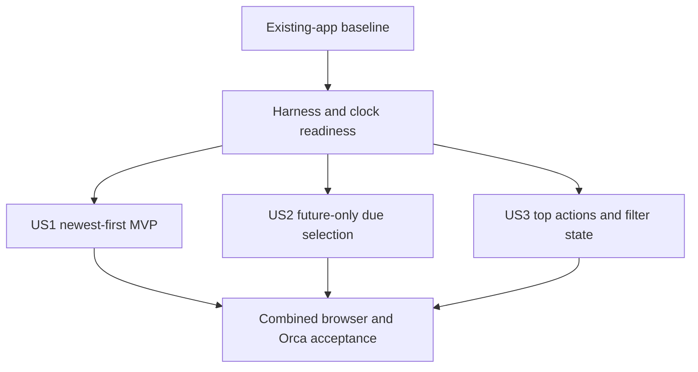

# Tasks: Refine Task List and Due-Date Selection

**Input**: [spec.md](spec.md), [plan.md](plan.md), [data-model.md](data-model.md),
[research.md](research.md), [contracts/rest-api.md](contracts/rest-api.md),
[quickstart.md](quickstart.md) and constitution v1.1.0.

**Tests**: TDD is required by the plan and constitution. Observe meaningful red assertions before
implementing each behaviour, then green and refactor. Missing imports alone do not complete a
behaviour's red/green acceptance. Do not rewrite expected outcomes simply to match old behaviour.
**Paths**: Repository-relative within the existing application. No project reinitialisation,
new dependency, schema migration or duration field is proposed.
**Format**: `- [ ] Tnnn [P?] [USn?] Description with exact file paths`.
[P] permits disjoint test-writing work within a batch after its phase prerequisites; it does
not permit shared source edits or skipping red baselines. Tasks are unchecked until executed.

## Phase 1: Setup — Verify Existing Application

**Goal**: Prepare this incremental change without reinitialising the app.

**Independent Test / Gate**: Existing application and approved toolchain are available; baseline state is recorded.

- [X] T001 Review package.json, package-lock.json, prisma/schema.prisma and specs/002-refine-task-list/plan.md against constitution v1.1.0; record that no new dependencies, migrations or ordinal rewrites are needed in specs/002-refine-task-list/validation-results.md.
- [X] T002 Run the existing unit, integration, component, typecheck, lint and build scripts from package.json; record baseline results and existing working-tree changes in specs/002-refine-task-list/validation-results.md without altering the running app or unrelated work.

**Checkpoint**: Recorded phase outcomes satisfy the gate before dependent work proceeds.

## Phase 2: Foundational — Shared Test Readiness

**Goal**: Reuse the current harness and define the temporal/fixture testing strategy.

**Independent Test / Gate**: Tests can use controlled clocks and legacy rows without modifying the development database.

- [X] T003 Verify tests/integration/database.ts provides isolated migrated SQLite files and tests/unit/client/setup.ts cleanup remains active; document loopback, Chrome, Orca and D-Bus prerequisites in specs/002-refine-task-list/validation-results.md.
- [X] T004 Inventory wall-clock-dependent due fixtures, ascending assertions and sidebar keyboard assumptions in tests/integration/api/todo-create-list.test.ts, tests/integration/api/todo-edit.test.ts, tests/unit/client/todo-edit.test.tsx and tests/e2e/accessibility-check.mjs; record the fixed-clock/legacy-seed adaptation strategy in specs/002-refine-task-list/validation-results.md before story changes.

**Checkpoint**: Recorded phase outcomes satisfy the gate before dependent work proceeds.

## Phase 3: User Story 1 — See New Tasks First (Priority: P1) — MVP

**Goal**: Display newest-created tasks first without changing ordinal allocation.

**Independent Test / Gate**: Seed ordinals 0/2/5 plus completed/deleted tasks; verify descending membership in both filters, new tasks first, and stable positions after edits.

- [X] T005 [P] [US1] Write failing descending-order and new-task-first repository/API assertions in tests/integration/repositories/todo-create-list.test.ts and tests/integration/api/todo-create-list.test.ts; cover ordinal gaps, deleted rows, both completion filters and unchanged order after editing older content.
- [X] T006 [P] [US1] Write failing rendered-order/refresh assertions in tests/unit/client/todo-create-list.test.tsx using mixed ordinal fixtures returned in descending order; verify newly created records become the first visible task without changing completion filtering.
- [X] T007 [US1] Change only list ordering to ordinal desc in src/server/repositories/todo.repository.ts; retain deleted/completed predicates, lifetime max allocation, uniqueness and transaction retries, making the repository/API assertions pass.
- [X] T008 [US1] Verify src/client/hooks/useTodos.ts and src/client/components/todo/TodoList.tsx preserve server ordering; remove an existing local ascending transform only if found, adapt remaining ascending fixture expectations in tests/integration/repositories/todo-create-list.test.ts and pass the US1 suites.

**Checkpoint**: The independent story scenario and related regression suites pass.

## Phase 4: User Story 2 — Select a Future Due Date and Time (Priority: P1)

**Goal**: Use native calendar/time choices with authoritative future validation and retained overdue edits.

**Independent Test / Gate**: With a fixed clock, reject past/bypassed/expired selections, accept future and null values, preserve unchanged overdue instants and verify atomic current-context checking.

- [X] T009 [P] [US2] Write failing contextual due-policy tests in tests/unit/shared/due-date.test.ts for create null/future/equal-now/past, update omission/null/exact-current-instant/different-past, offset normalisation and readable overdue response schemas.
- [X] T010 [P] [US2] Write failing clock-injected service and transaction-callback tests in tests/unit/server/todo-due-date.service.test.ts for current-row comparison, rollback on rejection, repeated callback invocation and a selection expiring before a retry writes.
- [X] T011 [P] [US2] Write failing POST/PATCH temporal contract tests in tests/integration/api/todo-create-list.test.ts and tests/integration/api/todo-edit.test.ts with a fixed service clock; seed legacy overdue rows directly and cover HTTP bypass, missing/deleted 404, unchanged overdue, null clearing and fields.dueAt errors without partial writes.
- [X] T012 [P] [US2] Write failing atomic validation tests in tests/integration/repositories/todo-due-date.test.ts for a due change racing a stale original, current-context re-read on retry, unchanged-overdue preservation and completion/deletion remaining usable on overdue tasks.
- [X] T013 [P] [US2] Write failing local eligibility/conversion tests in tests/unit/client/datetime.test.ts and tests/unit/client/timezone.test.ts for local today, partly elapsed minute, hour eligibility, 23:59 exhaustion, midnight rollover, timezone boundaries, DST gap/earlier-overlap behaviour and redisplaying a canonical instant after a browser timezone change.
- [X] T014 [P] [US2] Write failing native-control/component tests in tests/unit/client/due-date-fields.test.tsx for date min, disabled hour/minute options, blank placeholders, optional/partial values, expired selection retention, minute/focus refresh and timer/listener cleanup on unmount.
- [X] T015 [P] [US2] Write and observe failing form integration assertions in tests/unit/client/todo-create-list.test.tsx, tests/unit/client/todo-edit.test.tsx and tests/unit/client/form-failures.test.tsx for title-only creation, retained overdue edit, replacement/clearing, server clock rejection, error/focus associations and an open form timezone change preserving a complete selection’s UTC instant; cover partial drafts without inventing an instant. Complete this red baseline before DueDateFields/TodoForm implementation.
- [X] T016 [US2] Implement the context-dependent Zod write policy in src/shared/schemas/due-date.schema.ts using proposed/current due instants and explicit nowMs; retain syntax-only historical instant parsing in src/shared/schemas/todo.schema.ts so read responses accept overdue records.
- [X] T017 [US2] Extend typed create/update repository methods in src/server/repositories/todo.repository.ts with synchronous service-owned validation callbacks; invoke them inside each write transaction immediately before mutation, reading current non-deleted state for edits and re-evaluating on bounded retries; preserve existing retry/error/ordinal guarantees.
- [X] T018 [US2] Integrate the shared policy and optional now() clock in src/server/services/todo.service.ts; reject invalid due assignments through the existing safe VALIDATION_ERROR/fields.dueAt format, preserve exact-current/omission/null semantics and keep business rules out of controllers/repositories.
- [X] T019 [US2] Adapt legacy test fixtures in tests/integration/api/todo-create-list.test.ts, tests/integration/api/todo-edit.test.ts and tests/unit/server/todo-create-list.service.test.ts to fixed clocks or isolated legacy seeding; pass all temporal service/repository/API tests without adding endpoints or changing wire field names.
- [X] T020 [US2] Implement pure local-date/hour/minute eligibility and UTC conversion helpers in src/client/utils/datetime.ts with explicit clock parameters, round-trip DST rejection, existing overlap policy and full-precision retained/selected instant preservation across timezone changes; keep partial local drafts without a canonical instant, and pass the datetime/timezone tests.
- [X] T021 [US2] Implement src/client/components/todo/DueDateFields.tsx with labelled native date input and Hour (24-hour)/Minute selects, local-today min, disabled ineligible options, empty placeholders, complete-group clearing and no silent default/advancement; show errors immediately under responsible controls.
- [X] T022 [US2] Integrate retained/change/clear/keep-existing modes and RHF/Zod group validation in src/client/components/todo/TodoForm.tsx; preserve original and complete unsaved UTC instants across timezone changes, leave partial drafts local with review feedback, reject partial/new past selections, send the existing single dueAt payload, map server group errors accessibly and retain Save/Cancel pending/failure behaviour.
- [X] T023 [US2] Add minute-boundary, focus/pageshow and field-interaction eligibility refresh with cleaned-up timers/listeners in src/client/components/todo/DueDateFields.tsx; recheck during TodoForm submission, preserve expired selections visibly with errors and allow correction/clear without silently rescheduling.
- [X] T024 [US2] Pass all T015 form integration assertions after T022–T023, then run US2 unit/component/API/repository suites from package.json and record fixed-clock, direct-bypass, stale-context and unchanged-overdue outcomes in specs/002-refine-task-list/validation-results.md; verify prisma/schema.prisma and migration history require no changes.

**Checkpoint**: The independent story scenario and related regression suites pass.

## Phase 5: User Story 3 — Top-Right Actions and Active Filter (Priority: P2)

**Goal**: Place actions above the list and make active filtering clear beyond colour.

**Independent Test / Gate**: Check action placement/order in all list states, toggle inclusive membership and verify colour, non-colour indication, pressed state and form-return filter retention.

- [X] T025 [US3] Write failing action-order/state RTL assertions in tests/unit/client/todo-create-list.test.tsx and tests/unit/client/todo-completion.test.tsx for actions preceding the list, create first, stable labels, active non-colour cue/aria-pressed and availability during empty/loading/error states.
- [X] T026 [US3] Move TodoListActions before the panel in src/client/pages/TodosPage.tsx and simplify src/client/components/todo/TodoListActions.tsx to an above-list action row; remove side-note/sidebar placement while preserving create/form/filter handlers and focus restoration.
- [X] T027 [US3] Update src/client/styles/app.css for a full-width wrapping top-right action row, distinct active/inactive Display completed colours, reserved-size non-colour indicator, forced-colors support, adequate text/control contrast and unclipped focus at narrow widths/zoom.
- [X] T028 [US3] Update src/client/components/todo/TodoListActions.tsx with the persistent non-colour active cue while retaining its accessible name and aria-pressed; pass US3 component tests and adapt focus assertions in tests/unit/client/todo-delete.test.tsx and tests/unit/client/todo-edit.test.tsx only where DOM traversal changed.

**Checkpoint**: The independent story scenario and related regression suites pass.

## Phase 6: Polish & Cross-Cutting Acceptance

**Goal**: Validate all three stories against the running build and preserve review evidence.

**Independent Test / Gate**: All automated gates and the scoped Chrome/Orca acceptance checks have recorded results.

- [X] T029 Update tests/e2e/browser-check.mjs for descending 100-task membership/order, above-list top-right geometry, native date/hour/minute restrictions, failed-save input retention and active filter styling; run the built app with disposable data and record the 20-trial list/filter/write timing results in specs/002-refine-task-list/validation-results.md.
- [X] T030 Update tests/e2e/accessibility-check.mjs for action-first keyboard traversal, native calendar navigation/dismissal, unavailable time options, partial/expired-value errors, retained overdue controls and forced-colors mode; run the isolated Orca session, review generated utterances and contrast/320px/200%-zoom checks, and record findings in tests/e2e/manual-acceptance.md.
- [X] T031 Fix recorded accessibility/browser findings only in the affected src/client/components/todo/, src/client/pages/TodosPage.tsx, src/client/utils/datetime.ts or src/client/styles/app.css files, adding red regression assertions before fixes; rerun each affected check and record resolved/unavailable outcomes in specs/002-refine-task-list/validation-results.md.
- [X] T032 Run all unit, integration and component tests plus typecheck, lint and build from package.json; verify no database/dependency changes and record requirement-by-requirement FR-001–012 and SC-001–005 results in specs/002-refine-task-list/validation-results.md without claiming unperformed checks passed.
- [X] T033 Update README.md and specs/002-refine-task-list/quickstart.md for newest-first lists, native future-time selection and top actions; mark only verified tasks complete in specs/002-refine-task-list/tasks.md and review git diff for unintended source, secrets, database files or dependency additions without committing/pushing/restarting the user app unless requested.

**Checkpoint**: Recorded phase outcomes satisfy the gate before dependent work proceeds.

## Dependencies & Execution Order

- Execute setup and foundations before changing feature behaviour. Each user story is testable
  against the existing CRUD app without requiring the other two stories' new behaviour.
- Default execution follows US1 → US2 → US3. US1 and US2 both edit the repository/API fixtures;
  US2 and US3 share form/page integration tests. Do not run those shared-file changes concurrently.
- For each story, marked test-writing tasks can run together on their disjoint paths after its
  prerequisites. Observe red results before writing the corresponding implementation.
- In US2, T009–T015 establish the red test batches before T016–T023 implementation. T015
  is specifically required before T021–T022 native controls/form integration; T024 verifies the
  form integration suite passes afterward. Shared policy precedes callback wiring and service integration. Tests may target the
  planned callback/clock seam before it exists; do not mark the story complete until actual
  policy assertions run and pass. Repository reads/validation/writes stay atomic on retries.
- Frontend eligibility helpers precede the native field component and form integration. Clock
  refresh and partial/retained modes must pass before the US2 checkpoint.
- US3 layout and state styling are checked together; RTL does not establish actual geometry or
  computed contrast, which are verified in the final Chrome/Orca phase.
- Final browser and Orca scripts share disposable service resources and some source fixtures;
  run them sequentially. Resolve findings and rerun affected checks before the final gate.

## Parallel Execution Examples per Story

| Story | Disjoint test-writing opportunities |
|---|---|
| US1 | Repository/API ordering assertions versus rendered-order component assertions |
| US2 | Shared policy, service callback, API contract, repository race, datetime and DueDateFields suites |
| US3 | No independent task-level parallel batch; its assertions touch shared component test files. The test runner may execute disjoint files concurrently |

Parallel markers do not instruct agent spawning. Do not introduce additional tooling to exploit
parallelism, and do not concurrently edit a file used by another task.

## Requirement Coverage

| Requirements | Story / acceptance evidence |
|---|---|
| FR-001–002, SC-001 | T005–T008, T029: descending repository/API/render order and 100-task checks |
| FR-003–005 | T009–T015, T020–T024, T029: native controls, eligibility, partial values and bypass |
| FR-006 | T009–T012, T015–T019, T022–T024: atomic callbacks, retries and expiry feedback |
| FR-007, SC-003 | T009–T012, T015, T017–T019, T022–T024: stored context, retention and clearing |
| FR-008 | T009, T013, T015–T016, T020, T022–T024: UTC/DST/precision and open-form timezone change |
| FR-009, SC-004 | T025–T027, T029–T030: action order, geometry, reflow and focus |
| FR-010–011 | T025–T030: active colour/cue, pressed state and forced-colors review |
| FR-012, SC-005 | T014–T015, T021–T023, T025–T031: labels/errors and keyboard/Orca/contrast |
| SC-002 | T009–T024, T029: invalid/past/partial/bypass matrix and native-control checks |

## Implementation Strategy

Deliver US1 after baseline readiness as the smallest reviewable increment: all list consumers
show newest-created first while the existing CRUD app remains usable. Add US2's backend policy
and native calendar/time selection as one complete story; do not enforce server future-only
writes without also supporting legacy overdue edits and clearable optional values. Add US3's
top action row and active state, then perform combined browser and screen-reader acceptance.

Reuse the existing tests and approved dependencies. If native picker behaviour fails the
specified target-browser requirements, document the gap and propose a narrowly scoped remedy;
any new dependency still needs the constitution's explicit review/approval. Do not silently
replace the accepted calendar/time semantics or introduce a custom calendar framework.

This task-generation command creates only this task list. It does not implement changes or
modify the currently running application.

## Phase 7: Convergence

Assessment of the present implementation against the feature artifacts identified three partial
plan obligations. Existing task records are preserved. Follow TDD for the regressions below;
retain the current API, native controls, UTC precision, retained-overdue semantics and pending/error behaviour.

- [ ] T034 Resolve F1 (MEDIUM): Make React Hook Form own the controlled due draft in src/client/components/todo/TodoForm.tsx and integrate date/hour/minute Zod group validation into its resolver, removing the stale parallel RHF dueAt value and separate post-content-validation path; adapt src/client/components/todo/DueDateFields.tsx as needed and add regression assertions in tests/unit/client/form-failures.test.tsx and tests/unit/client/todo-edit.test.tsx for integrated validation, retained/change/clear modes, timezone precision, server errors and focus per plan: US2 "RHF owns the form state" and T022 (partial).
- [ ] T035 Resolve F2 (MEDIUM): Refresh the clock and timezone-dependent availability when the native date, hour or minute control receives focus in src/client/components/todo/DueDateFields.tsx, preserving selected instants and existing timer/listener cleanup; first add fixed-clock tests in tests/unit/client/due-date-fields.test.tsx that advance system time without firing the timer/window events and verify field focus updates date min, disabled options and expired-selection feedback per plan: US2 field-focus refresh, T023 and FR-005 (partial).
- [ ] T036 Resolve F3 (LOW): Show accessible, date-associated guidance in src/client/components/todo/DueDateFields.tsx when today has no eligible remaining minutes, inviting the user to choose a future date without selecting or advancing any value; add controlled-clock tests in tests/unit/client/due-date-fields.test.tsx for 23:59 exhaustion, future-date recovery and midnight rollover per plan: US2 end-of-day guidance and FR-005 (partial).
